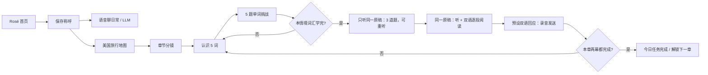

# Between / Rosé

Rosé 是声音与角色驱动的 AI 伙伴。首页承载日常交流，美国旅行是当前唯一的学习场景。界面明确标注非官方 AI 角色演绎，不表示 ROSÉ 本人参与、私聊或背书。

## 核心页面与静态结构

- `/`：纯白全屏聊天流，只保留角色头像；场景卡片嵌入消息流顶部，底部固定语音输入。角色名为 Rosé，不展示气泡署名或语言选择。点击左上角打开角色抽屉，顶部 Hi + 可编辑的用户称呼，其次是新增、探索和四位成员的头像列表；右上角加号进入新增场景页。首页对话由 OpenRouter 提供；英文回应和中文译文一起保存，回应音频按需生成并私有缓存。
- `/travel`：七天纽约旅程、每日任务、钻石和成长。章节在同页以白色内容区和固定底部按钮展开。

- `/characters/new`：新增角色静态表单，声音上传和创建按钮未启用。
- `/explore`：四位成员的角色卡片。
- `/characters/jennie`、`/characters/jisoo`、`/characters/lisa`：静态角色预览，不请求 LLM 或声音服务。
- `/scenes/new`：新增场景静态表单，创建按钮未启用。

昵称修改复用已有匿名用户数据并保存，其他新增页面只搭产品结构。首页锁定文档滚动，只有消息列表可滚动；角色抽屉有独立滚动、焦点约束与 Escape 关闭，并在关闭后将焦点返回左上角。

## 第一套学习材料

| 天 | 旅途事件 | 两个情境 |
| --- | --- | --- |
| 1 | 抵达纽约 | 机场入境与行李、接驳车与酒店入住 |
| 2 | 一个慢早晨 | 咖啡馆点餐、中央公园与合照 |
| 3 | 读懂城市 | 地铁方向与换乘、大都会博物馆与导览 |
| 4 | 计划外的美好 | 市集试吃与付款、布鲁克林大桥日落 |
| 5 | 改变计划 | 雨天问路、药房沟通与休息 |
| 6 | 一起过一个夜晚 | 餐厅用餐、百老汇演出 |
| 7 | 带回日常 | 明信片与邮票、机场离境 |

每章两个情境，每个情境 10 个词与表达，包含音标、中文意思、英文用法和中文例句。每 5 个词先认识再答题；不是只学少量样例词。整套共 140 个词汇条目。

每幕的原稿包含一段场景叙述与两句 Rosé 台词。`materialBlocks` 是阅读展示与 `materialText` 是对应音频文本，均来自同一份原稿；听力与阅读没有分开编写两套内容。每幕最后提供一段预写中英双语回应，部分含多句话。材料不调用大语言模型即时生成。

开场先用四步说明学习顺序、每词赚 1 钻石、2 钻石解锁听力文稿，以及口语与章节积累心动值，再进入剧情。每天一章共有 47 个进度位置：1 个开场 + 2 幕 ×（10 次认识词汇 + 10 题单词挑战 + 听力 + 阅读 + 口语）。完整朗读一段回应、回放确认后发送，保存成功才推进。口语阶段不做语音识别或发音准确率评分。听力每幕有 3 道预写题，累计完成才进入阅读。阅读按语义对齐的中英小段翻页，口语先听角色再展示回应稿，使主要内容和底部操作在 390×600 的手机视口内可见。

## 机制

- 单词挑战答对：每个新词 +1 钻石、+10 XP。答错可重试，不扣既有奖励。
- 听力每幕三题分别 +2、+2、+1 XP；阅读 +5 XP，总 XP 沿用已有规则。
- 每幕发送口语：+15 XP、熟悉 +3、心动 +1。
- 首次完成整章：额外熟悉 +4、心动 +3；整章共 250 XP、熟悉 +10、心动 +5。
- 听力文稿提示消耗 2 钻石，同一提示重复点击不再次扣款。不使用钻石也可以完成所有章节。
- 完成整章才计入每日任务。按北京时间计算日期与连续天数；漏一天不扣累计成长。
- 章节按顺序解锁，每天可多学。回看不重复领奖；重复请求也不重复领奖。

答对或发送录音后直接推进，右上角数值闪动并显示增量，不插入领奖卡或额外继续按钮。所有成长、钻石、提示与章节步骤都由服务端结算并保存。听力子题进度保存在 `run.listening[cursor]`，客户端带子题序号，重试同一子题不会误提交下一题；原有 47 步的顺序与录音键保持不变，不重置旧用户的进度。旧版故事记录保留在原键空间，新旅程使用 `us-with-rosie-v1`。发布后若修改顺序或材料结构，需要更新 `COURSE_ID`，避免既有进度错位。

## 声音、照片与交互

沿用已配置的 Cartesia 音色，不新增声音市场或切换功能。旁白和角色台词使用既有克隆音色；单词和回应提示使用现有 edge-tts 服务，故障时有手动系统朗读备选。系统朗读不能导出缓存，会明确标注不保存。正常服务均先保存成功再给播放地址。

界面使用纯白背景、黑色主按钮和灰色辅助信息。移除照片蒙版、绿色底色、首页底部说明以及气泡中的角色名字。学习引导保留四阶段顺序与钻石用途；答对后右上角反馈，底部操作固定。图片署名与 AI 角色说明收进抽屉的「关于与来源」。

素材库保留已有公开活动照片与 14 张 AI 旅行背景，当前白色界面不加载背景图。成员列表另有三张明确许可的 Jennie、Jisoo、Lisa 公开活动照片，仅用于头像和静态预览，来源与条款在 `public/characters/sources.json`、`LICENSE.txt` 及页面来源入口中记录。新增成员不使用 Rosé 的音色假装对话。

## 首页对话与环境

首页使用 `OPENROUTER_API_KEY`，默认模型 `deepseek/deepseek-v4-flash`，可通过 `OPENROUTER_MODEL` 改为账号实际可用的模型 ID。密钥只读于服务端，不写前端或 Git。仅用户发送口语后请求 LLM，成功后持久保存中英双语，再按本条互动生成回应语音。最近 40 组交流保留在当前匿名用户记录中，最近 8 组进入上下文。请求 ID 保证发送重试不会再次调用或追加同一回应。

首页口语由浏览器 Speech Recognition 转成文本后发送，支持的浏览器可能使用系统识别服务；此机制与学习页的纯录音不同。浏览器没有语音识别能力时会明确提示，不伪装成已理解用户录音。LLM 缺少配置时首页显示待连接，旅行学习仍然可用。

复用现有 Supabase `between_records`、`between-audio`、租约 RPC；无需新增 SQL。`/api/status` 的 `homeChat` 只说明密钥存在，不证明上游模型连通。没有登录，记录绑定当前浏览器的匿名 Cookie。
